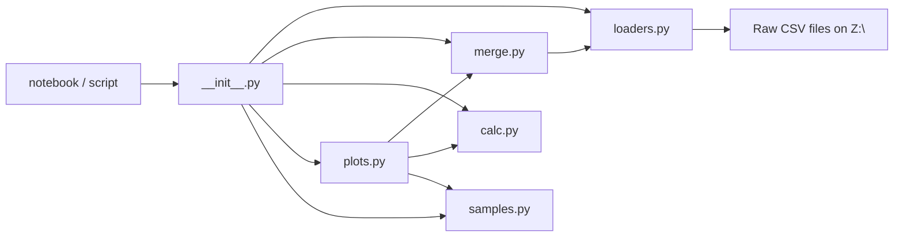

# Current State

### What the repo looks like now

```
VECTOR/
├── README.md              # Bloated, full of "Copier" artifacts, mostly generic Conda/Spyder/Jupyter boilerplate
├── environment.yml        # Only 4 packages (python, pandas, matplotlib, numpy) — missing jupyter, spyder
├── .gitignore             # Minimal (Conda, Jupyter, Spyder entries)
├── VECTORtools/           # Package directory
│   ├── __init__.py        # Empty
│   ├── VECTORtools.py     # 324 lines — all data loading, merging, calculations, and plotting in one file
│   └── sampleDictFile.py  # 190 lines — one giant dictionary literal with ~46 sample configs
└── notebooks/
    └── VECTOR_jupyter.ipynb  # Broken imports (`triPlot` not defined), hardcoded `Z:\` path
```

### Problems
1. **No `pyproject.toml`** — `pip install -e .` fails, so the package is never importable.
2. **README is mostly generic boilerplate** — Conda setup, Spyder/Jupyter instructions, env var examples — none of it specific to this project. Full of "Copier" paste artifacts.
3. **All code in one file** — data loading, merging, calculations, and plotting are mixed together in `VECTORtools.py`.
4. **Empty `__init__.py`** — no public API, so `from VECTORtools import *` doesn't work reliably.
5. **Hardcoded `Z:\RawData\TestCata`** everywhere — default args in every function, notebook, and README.
6. **`.gitignore` is minimal** — missing `__pycache__/`, `*.pyc`, `.venv/`, `*.egg-info/`.
7. **`environment.yml` is incomplete** — missing jupyterlab, ipykernel (used in the notebook).
8. **`sampleDictFile.py` is a bare dictionary** — no validation, no way to check if a sample's files exist before running.

# Proposed Reorganization

### New structure

```
VECTOR/
├── README.md                   # Slim: what the tool does, setup instructions, usage examples
├── environment.yml             # Conda dependencies (pandas, matplotlib, numpy, jupyterlab, ipykernel)
├── .gitignore                  # Expanded with standard Python patterns
├── VECTORtools/
│   ├── __init__.py             # Exports public API (loadGDS, loadOPC, loadGC, mergeOnGDS, etc.)
│   ├── loaders.py              # loadGDS, loadOPC, loadGC, loadMS (data loading only)
│   ├── merge.py                # mergeOnGDS, mergeOnGC (alignment logic)
│   ├── calc.py                 # calcConv, calcSelect (conversions & selectivity)
│   ├── plots.py                # OverviewPlot, triPlot, tempPlot, tweakTimeOffset, carbonBalance
│   └── samples.py              # sampleDict + a helper to validate paths exist
└── notebooks/
    └── VECTOR_jupyter.ipynb    # Uses sys.path.append to import VECTORtools, no pip install needed
```

### What changes and why

| Change | Reason |
|--------|--------|
| **Split `VECTORtools.py` into 5 modules** | Separates concerns: loaders don't depend on plots, calculations are testable in isolation |
| **Populate `__init__.py`** | Explicit `__all__` so `from VECTORtools import *` works, and IDE autocomplete works |
| **Data path from `DATA_PATH` env var** | Single default in `merge.py` via `os.getenv("DATA_PATH", "Z:/RawData/TestCata")` — no more hardcoded paths in every function |
| **Slim README** | Remove all generic Conda/Spyder/Jupyter boilerplate. Keep: what the tool does, Conda setup command, 2-3 code examples |
| **Expand `.gitignore`** | Add `__pycache__/`, `*.pyc`, `.venv/`, `*.egg-info/`, `dist/`, `build/` |
| **Fix notebook imports** | Add `sys.path.insert` so `from VECTORtools import *` works without `pip install` |
| **`samples.py` path validation helper** | A small function that checks if a sample's GDS/OPC/GC files exist before you try to plot |

### Key design decisions

1. **Keep it a single package** — no need for a separate analysis library vs CLI. This is a research tool, not a product.
2. **No config file** — the sample dictionary *is* the config. Adding a YAML config layer adds complexity without benefit for ~46 samples.
3. **No tests for now** — the data files live on a network drive (`Z:\`), making automated tests impractical. The focus is on making the code importable and organized.
4. **`environment.yml`** is the single source of truth for dependencies — no `pyproject.toml` needed. Users just create the Conda env and run the notebook directly.

### Architecture



### What the README becomes

```markdown

# VECTORtools

Catalysis data analysis: loads GDS (gas flows), OPC (temperature), and GC (gas concentrations) instrument data, merges by timestamp, and produces conversion/selectivity plots.

## Setup

    conda env create -f environment.yml
    conda activate vector

No installation step required — just run the Jupyter notebook.

## Usage

```python
from VECTORtools import mergeOnGDS, triPlot, carbonBalance, sampleDict

# Single sample overview

carbonBalance('DR60-40')

# Compare multiple samples

triPlot(['DR60-40', 'DR58-3_2', 'DR60-26_2'])
```

Set `DATA_PATH` environment variable to override the default data directory (`Z:/RawData/TestCata`).
```

# Delivery Steps

### ✓ Step 1: Split VECTORtools.py into modules
Break the monolithic file into focused modules (no `pyproject.toml` — no pip install needed).
- Create `pyproject.toml` was skipped — no installation step required.
- Split `VECTORtools.py` into: `loaders.py` (loadGDS, loadOPC, loadGC, loadMS), `merge.py` (mergeOnGDS, mergeOnGC), `calc.py` (calcConv, calcSelect), `plots.py` (all plot functions).
- Rename `sampleDictFile.py` to `samples.py` and add a `validate_sample(sample, data_path)` helper that checks if GDS/OPC/GC files exist.
- Update imports between modules so each module imports from siblings (e.g., `plots.py` imports from `merge.py` and `calc.py`).

### ✓ Step 2: Update __init__.py, fix paths, clean README and gitignore
Wire up the public API, remove hardcoded paths, and clean the project metadata.
- Populate `__init__.py` with explicit `__all__` listing all public functions and `sampleDict`, importing from the sub-modules.
- Replace hardcoded `Z:\RawData\TestCata` defaults in `plots.py` and `merge.py` with `Path(os.getenv("DATA_PATH", "Z:/RawData/TestCata"))`.
- Rewrite `README.md` to ~20 lines: what the tool does, Conda setup command, usage examples, and the `DATA_PATH` env var note. No `pip install` step.
- Expand `.gitignore` with `__pycache__/`, `*.pyc`, `.venv/`, `*.egg-info/`, `dist/`, `build/`, `.idea/`.
- Fix the notebook: add `sys.path.insert` so `from VECTORtools import *` works without installation.

### ✓ Step 3: Fix indentation bugs and deduplicate merge functions
Fix the remaining code quality issues identified in the review.
- Fix tab indentation in `triPlot` (lines 201-209 in plots.py) — convert tabs to spaces.
- Deduplicate `mergeOnGDS` and `mergeOnGC` by extracting a shared `_merge_instruments(base_df, other_dfs, base_time_col)` helper in `merge.py`.
- Add division-by-zero protection in `calcSelect`: use `np.where` or a small epsilon to avoid `0/0` warnings.
- Replace `inplace=True` calls with reassignment (modern pandas style) across all loaders.